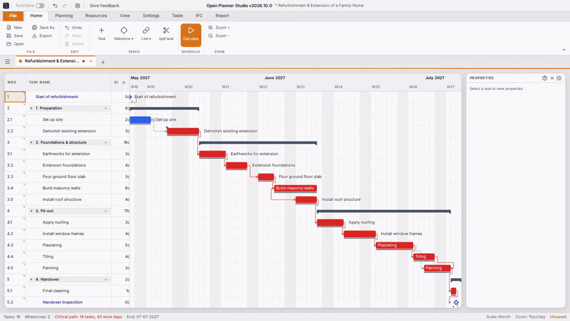
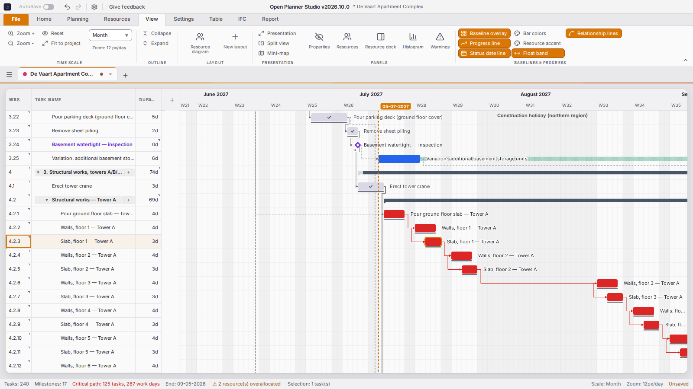
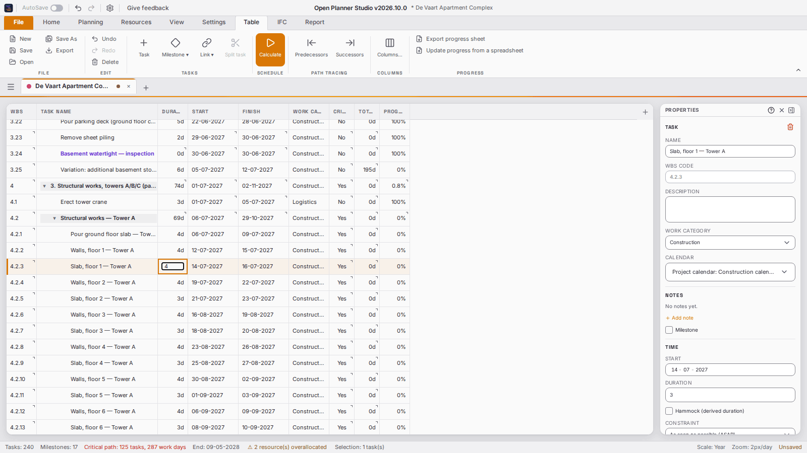
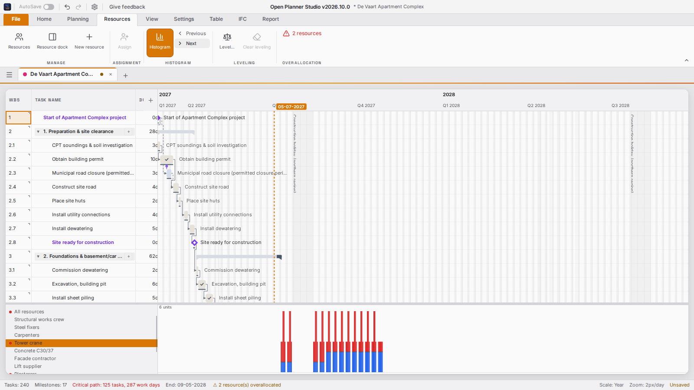
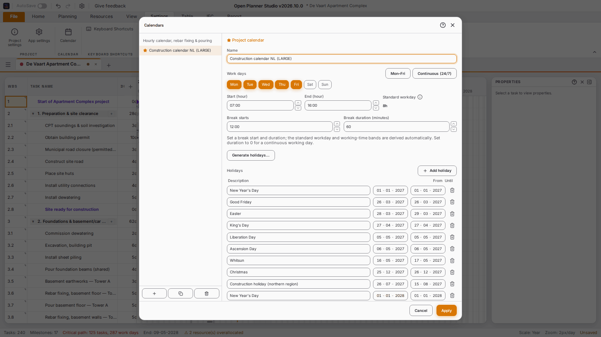
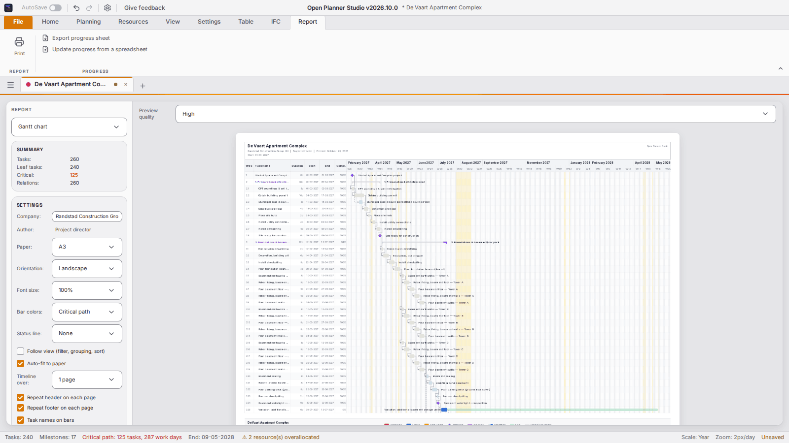
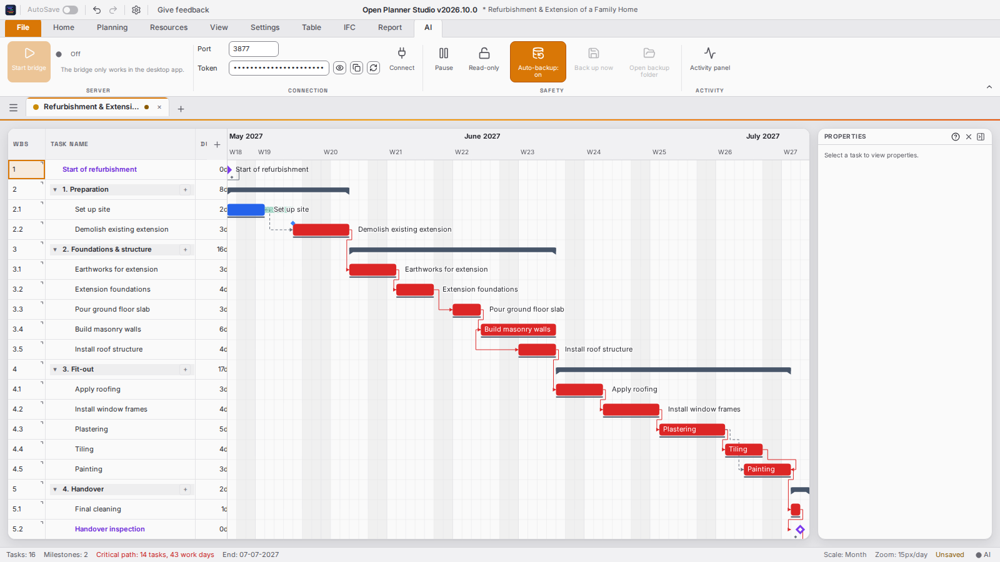
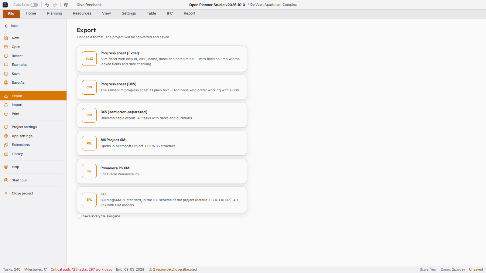
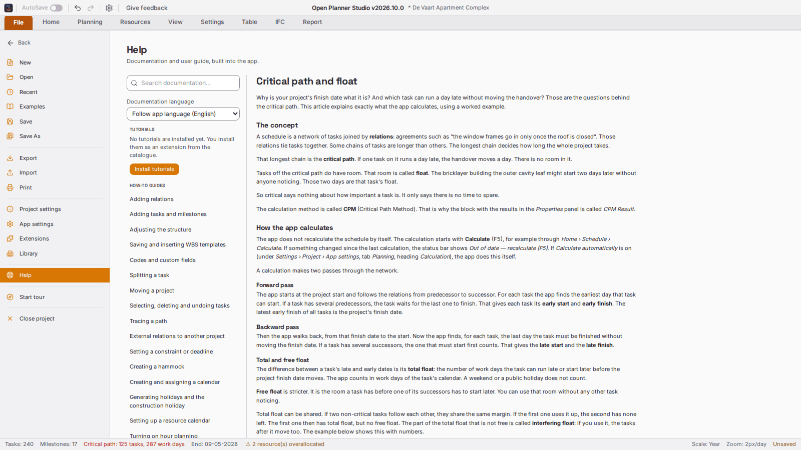

**English** · [Nederlands](README.nl.md)

<div align="center">

# Open Planner Studio

**Open-source construction scheduling. Critical path, MS Project and Primavera P6 files, IFC 4.3 as the native format, and an MCP server.**

[](https://github.com/OpenAEC-Foundation/open-planner-studio/releases)
[](https://github.com/OpenAEC-Foundation/open-planner-studio/releases)
[](https://github.com/OpenAEC-Foundation/open-planner-studio/actions/workflows/ci.yml)
[](src/i18n/config.ts)
[](#license)

### [Try in your browser](https://open-planner-studio.open-aec.com/) &nbsp;·&nbsp; [Download](https://github.com/OpenAEC-Foundation/open-planner-studio/releases/latest)



</div>

Open Planner Studio (OPS) is a free scheduling application for the construction industry. It calculates a schedule with the Critical Path Method, opens and writes the file formats planners already use, and saves in IFC 4.3, the open building standard.

It runs in your browser with nothing to install, or as a small native desktop app on Windows, macOS and Linux.

## Try it

**[Open the browser version](https://open-planner-studio.open-aec.com/)**. It starts with a realistic example project, so you can start clicking right away. More examples are under *File › Examples*.

The built-in Help has **78 published articles** in English and Dutch, with translations in the other UI languages. You can also read the [wiki](https://github.com/OpenAEC-Foundation/open-planner-studio/wiki) or visit the [website](https://open-aec.com/open-planner-studio/).

## Download

Every release is on the [releases page](https://github.com/OpenAEC-Foundation/open-planner-studio/releases/latest).

| Platform | Installer |
|----------|-----------|
| **Windows** | `.exe` installer (x64) |
| **macOS** | `.dmg` (universal: Apple silicon and Intel) |
| **Linux** | `.deb`, `.rpm`, `.AppImage`, or the [Snap Store](https://snapcraft.io/open-planner-studio) |

Installed apps update themselves when a new version is out (Windows, macOS, `.deb`, `.rpm` and AppImage). The Snap version updates through the Snap Store.

## Why use it?

- **Free and open.** LGPL-3.0. No licence fees, no account, no lock-in.
- **Open formats.** IFC 4.3 is the native project format. There is no private binary format.
- **Works with your existing files.** Open Microsoft Project (`.mpp`, `.xml`) and Primavera P6 (`.xer`, `.xml`) files, and export to MS Project XML, P6 XML and CSV.
- **Scheduling rules you can choose.** Calculate with Primavera P6, Microsoft Project or Open Planner Studio conventions, per project.
- **Built for construction.** Public holidays, building-trade holidays, work calendars, inspection milestones, phasing, resource levelling.
- **MCP.** A built-in MCP server lets an AI assistant read and edit your schedule, with safety switches you control.
- **Multilingual.** 28 languages, including right-to-left Arabic and Persian.

## Screenshots

| | |
|---|---|
|  **Critical path and float** |  **Spreadsheet-style task table** |
|  **Resource histogram and levelling** |  **Calendars and working time** |
|  **Reports with live preview** |  **MCP** |
|  **Export to other formats** |  **In-app help** |

## Advanced scheduling

- **Critical Path Method** with total, free and interfering float, negative float, and a recalculation you trigger yourself (or switch to automatic).
- **All eight constraint types:** As Soon As Possible, As Late As Possible, Start/Finish No Earlier Than, Start/Finish No Later Than, Must Start On, Must Finish On (optionally mandatory, "pin logic"), plus task deadlines. See [Constraints](public/docs/en/uitleg-constraints.md).
- **All four relationship types** (FS, SS, FF, SF) with positive and negative lag, in days or hours.
- **Hammock tasks** (level of effort) that follow the work they hang on. See [Creating a hammock](public/docs/en/howto-hammock.md).
- **External (cross-project) relations.** A task can depend on a task in another project file through a stored anchor date. The link is not live: the other project is not recalculated. See [External relations](public/docs/en/howto-externe-relaties.md).
- **Near-critical tasks** with a threshold you set, and **multiple float paths** (path 1, 2, 3 ...) to see more than the single longest chain.
- **Calculation profiles.** Three built-in profiles: *Open Planner Studio*, *Primavera P6* and *Microsoft Project*. A profile is a set of conventions for the places where the two products calculate differently. See [Calculation profiles](public/docs/en/uitleg-rekenprofielen.md).
- **Task types (work rules).** Choose fixed duration and units, fixed duration and work, fixed work or fixed units per task. Duration, resource units and work adjust together when you edit them. Assignments have one row per resource, with units and remaining work in hours. See [Task types](public/docs/en/uitleg-werkregels.md).
- **Days and hours.** Choose the duration unit per task; hours display as `10h` in English (`10u` in Dutch).
- Work breakdown structure, baselines, progress and status date, task splitting in the Gantt, resource levelling and a cross-project occupancy view.
- **Resource libraries.** Share resources and calendars across projects, with provenance recorded for each item.

## Interoperability

IFC 4.3 ADD2 is the default native format, written as schema-valid IFC. Every other format is an adapter. What works per format (full detail in [Import and export formats](public/docs/en/ref-import-exportformaten.md)):

| Format | Open | Save / export |
|--------|------|---------------|
| **IFC** (4 and 4.3) | Yes | Yes, the only format you save to. Carries the whole project |
| **MS Project XML** (MSPDI) | Yes | Export |
| **MS Project `.mpp`** (2010 to 2021) | Yes, read-only | No |
| **Primavera P6 XML** | Yes, several projects per file | Export |
| **Primavera P6 `.xer`** | Yes, read-only; one tab per project | No |
| **CSV** | Yes | Export |

The original `.xer` is kept inside the saved IFC. **Dates as recorded** shows the dates saved by P6 or MS Project before you recalculate.

Progress can also go through a spreadsheet: export a progress sheet (`.xlsx` or `.csv`), fill it in on site, and read it back into the open project.

Some data does not survive every format, for example baselines in `.mpp`, or activity codes in MS Project XML. The documentation lists exactly what goes along and what changes. The `.mpp` reader was written for OPS and is derived from the structure knowledge of [MPXJ](https://github.com/joniles/mpxj) (LGPL-2.1).

## Reporting

Eleven report types, with a live preview, exported to PDF (A4 to A1):

Gantt chart, Resource diagram, Milestone overview, Variance, Look-ahead, Critical and near-critical, Progress report, Schedule health, Resource loading, Resource assignments, WBS summary.

Schedule health includes a DCMA 14-point check. Reports can cover a reporting period, compare against a baseline and follow the filter and grouping of your screen (Gantt chart). See [Report types](public/docs/en/ref-rapporttypes.md).

## MCP

OPS can run a local **MCP server** (Model Context Protocol) so that an AI assistant works with the schedule you have open. It offers 41 `planner_*` tools to read and change tasks, relations, resources, calendars, baselines and documents. You decide what the assistant may do: pause, read-only mode, automatic backups and an activity log are on the *AI* tab. The server is off by default and runs in the desktop app only.

See [Connecting an AI assistant](public/docs/en/howto-ai-assistent-koppelen.md) and the [tool reference](public/docs/en/ref-ai-tools.md).

## Testing and reliability

**Tested on real MS Project and P6 schedules.** The counts below come from the code and pinned test manifests in this repository. They describe test coverage, not a guarantee for every file.

- **573 data-driven scheduling cases** in 24 batteries (`tests/planning/cases-*.json`). Expected values are worked out by hand from CPM theory, not copied from the engine's own output.
- **424 further contract-check files** (`tests/planning/check-*.ts`), and a timezone matrix across five time zones.
- **Browser tests.** 135 Playwright spec files drive real Chromium with real mouse and keyboard events (`tests/browser/`).
- **MS Project fidelity.** A pinned baseline of 216 `.mpp` files (3,413 tasks) records that after recalculation every start and finish equals the dates MS Project saved in the file. The files themselves are not in this repository, so this gate runs only on a machine that has them. The baseline is in [`tests/planning/mpp-fidelity-baseline.json`](tests/planning/mpp-fidelity-baseline.json).
- **Primavera P6 comparison.** 93 public `.xer` files are classified by origin. Nine of them, calculated by P6 itself, serve as the reference ([`tests/planning/xer-corpus-manifest.json`](tests/planning/xer-corpus-manifest.json)).
- **Other formats.** MS Project XML (MSPDI), P6 XML, CSV and IFC have import/export and round-trip contract checks in `tests/planning/`; there is no single external-corpus count stated for them.
- **Five suites** run behind `npm test`: `planning`, `library`, `mcp`, `dev-server` and `browser`.
- CI runs the whole gate (`npm run verify`) on every pull request. A red suite blocks the deploy and the release.

Count sources: [`public/docs/manifest.json`](public/docs/manifest.json) (published articles; drafts excluded), [`src/i18n/locales.ts`](src/i18n/locales.ts) (28 languages), [`src/services/mcp/toolRegistry.ts`](src/services/mcp/toolRegistry.ts) and its registered modules (41 tools). Scheduling and browser counts use the file patterns above.

## Current limitations

OPS is young software. Know these before you rely on it:

- **`.mpp` and `.xer` are read-only.** You cannot write either format. Save goes to IFC. Export to MS Project XML or P6 XML to hand a schedule back.
- **`.mpp` does not bring baselines, costs, rates, notes or custom fields.** Files from MS Project 2007 or older, and password-protected files, are refused.
- **No cost management.** Resources can carry an hourly rate, but OPS has no cost reports or cost curves. It schedules time and resources.
- **Cross-project relations use a fixed anchor date.** They are not recalculated live with the other project.
- **P6 XML export drops** baselines, deadlines, activity codes, custom fields and notes.
- **The MCP server needs the desktop app.** In the browser the AI tab is visible but the bridge does not start.
- **4D BIM is on the roadmap, not built.** Linking tasks to elements of an IFC building model is not implemented yet. Because the schedule is a standard IFC 4.3 file, you can already merge it with a building model and link tasks to elements in other IFC tools, such as IfcOpenShell or Bonsai. See [Choosing the IFC schema](public/docs/en/howto-ifc-schema-kiezen.md). We give no guarantees about how those tools behave.
- **Known issues.** [`knownbugs.md`](knownbugs.md) lists open problems, for example around some constraint edge cases and the hour-based scheduling of progress.
- **Calculation parity is measured, not guaranteed.** OPS follows P6 and MS Project conventions closely, but an exotic schedule can still calculate differently. Compare critical results before you hand off.

Found something? [Open an issue](https://github.com/OpenAEC-Foundation/open-planner-studio/issues).

## Under the hood

The desktop app is built with Tauri 2, so the installers are small and use the web view of the system. The Rust part is a thin native shell with three commands. The scheduling engine is written in TypeScript. It is the same code in the browser and on the desktop. The user interface is React 19, and the Gantt timeline is drawn on a Canvas 2D surface.

## Contributing

- **Try it on a real project** and report bugs or missing features: use the feedback button in the app, or [open a GitHub issue](https://github.com/OpenAEC-Foundation/open-planner-studio/issues/new).
- **Share ideas or ask questions** in [GitHub Discussions](https://github.com/OpenAEC-Foundation/open-planner-studio/discussions).
- **Send test files.** `.mpp`, `.xer` and P6 XML files help us improve the import, and a large set of test files may later help us improve the export as well. See [the discussion on test files](https://github.com/OpenAEC-Foundation/open-planner-studio/discussions/71). Remove confidential data first.
- **Write code.** Read [CONTRIBUTING.md](CONTRIBUTING.md) and open a pull request.

## Quick start (developers)

```bash
npm ci        # not "install": the lockfile is binding
npm run dev   # prints the port it runs on
```

Requires Node 22. Rust is needed only for `npm run tauri:dev` and `npm run tauri:build`.

Stack: Tauri 2, React 19 and TypeScript, Canvas 2D for the Gantt timeline, Zustand and Immer, TailwindCSS 4, Vite, react-i18next.

For architecture, the test gate and conventions, read [CONTRIBUTING.md](CONTRIBUTING.md) and [AGENTS.md](AGENTS.md). The roadmap is in [PLAN.md](PLAN.md). Report security problems through [SECURITY.md](SECURITY.md), not an issue.

Open Planner Studio is part of the [OpenAEC Foundation](https://github.com/OpenAEC-Foundation) family of apps.

## License

LGPL-3.0. See [LICENSE](LICENSE).

## Trademarks

Microsoft Project is a trademark of Microsoft Corporation. Oracle Primavera P6 is a trademark of Oracle. Open Planner Studio is an independent project and is not affiliated with, endorsed by or sponsored by Microsoft or Oracle. These names appear only to describe file compatibility.
