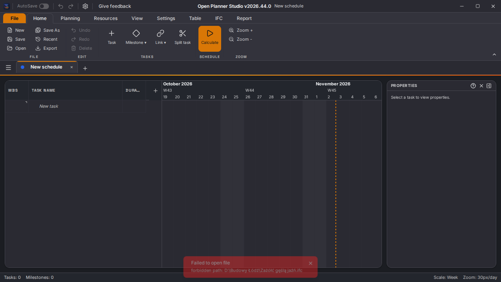

# Recente projecten: leesfouten en bestandstoegang

Onderzoek voor issue #782 op 2 november 2026. Het volledige issue is gelezen; het heeft geen reacties.
De eigen worktree begon op de toen nieuwste `origin/main`:
`1f0de72fe8924878a2be405e91dc22910789cf07`.
De tests zijn eerst vastgelegd in `627ce53dc`, zonder wijzigingen aan productcode.
De reparatie staat in `b177337aa`. Daarna is de matrix aangescherpt zodat elke afzonderlijke
leesfout begint met een aanwezige, gepersisteerde entry; ook die versie is tegen main gecontroleerd.

## Oorzaak

`readFromRefTauri` en `readBytesFromRefTauri` vingen iedere native leesfout af en gaven `null` terug.
De webbackend deed hetzelfde bij leesfouten of geweigerde toegang. `openRecentFile` verwijderde bij
`null` de entry uit IndexedDB en de zichtbare lijst, zonder melding. Het actieve document bleef
staan. Vanuit een leeg begintabblad lijkt dit op het openen van een leeg project.

Daarnaast ontbrak het bewaren van de via de native bestandskiezer verleende toegang. De vaste
capabilities dekken de thuismap; een gekozen bestand op bijvoorbeeld `D:\Budowy Łódź\Żółć.ifc`
krijgt tijdelijk toegang. Na een appherstart vervalt die toestemming. Dit is een concrete oorzaak
van leesweigeringen in de huidige configuratie; het issue bevat geen pad of log om vast te stellen
of juist deze oorzaak bij de melder optrad.

Tauri documenteert dat [de toegang via de bestandskiezer tijdelijk is](https://v2.tauri.app/reference/javascript/dialog/)
en biedt [persisted-scope](https://v2.tauri.app/plugin/persisted-scope/) om die te bewaren. De plugin
staat nu na `fs`, met versie 2.3.6 die past bij de al vergrendelde `tauri-plugin-fs` 2.5.0. Aan de
lockfile zijn alleen deze plugin, zijn dependency `bincode` en de dependency van de app toegevoegd.
De plugin verleent geen toegang op basis van de inhoud van de recente lijst.

Leesfouten gaan nu naar de bestaande melding `notifications.openFailed`, inclusief de reden. Bij
geweigerde browsertoestemming zonder foutreden wordt de bestandsnaam getoond. Project, undo en
recente entry blijven behouden, zodat een nieuwe poging mogelijk is. Er is geen nieuwe vertaaltekst,
schermindeling of IFC-veld toegevoegd.

## Bewijs vóór en na de reparatie

Omgeving: Node v24.22.0 op aia09-mp50. Alle onderstaande runs zijn gericht en gingen één voor één
door het gedeelde testslot. De volledige suites en native builds zijn lokaal niet uitgevoerd.

`flock /tmp/ops-zwaar.lock bash tests/planning/run.sh check-recent-open.ts`

- Main met alleen de nieuwe test: eerst **76 controles, 26 afwijkingen, exit 1**; na het onafhankelijk
  maken van de foutgevallen **76 controles, 42 afwijkingen, exit 1**. Voor die tweede vergelijking
  zijn alleen de betrokken bronbestanden uit de hierboven gepinde main tijdelijk teruggezet, met
  een kopie onder `/tmp` en herstel via `cp`; daarna is exact dezelfde test tegen de fix herhaald.
- Na de reparatie: **76 controles, 0 afwijkingen, exit 0**.
- De matrix gebruikt de echte store, parser, recent-opslag en Tauri-JS-plugin. Alleen de native
  I/O-rand is vervangen: ontbrekend bestand, verboden pad, een stringfout en een `Error`; tekst
  en bytes; leeg en gevuld document; behoud van alle documenten, opslagdoelen, undo en de lijst
  na opnieuw lezen uit IndexedDB. De webroute toetst geweigerde toestemming en `NotFoundError`.
- Succesgevallen lezen echte IFC-inhoud via Poolse tekens in een Windows-pad en een UNC-pad.
  Deze succesgevallen slagen ook op main: er is hier geen aanwijzing voor een tekenconversiefout.
- Twee configuratiecontroles bewaken dependency en registratievolgorde van `persisted-scope`.
  Dit zijn broncontroles, geen uitgevoerde native herstarttest.

`node_modules/.bin/playwright test --config /tmp/ops-782-playwright.config.mjs tests/browser/recent-files.spec.ts`

- Main: **1 gefaald, exit 1**. De echte klik op het recente item komt aan; de verwachte foutmelding
  ontbreekt. De fout zit bij de eerste toastassertie, niet bij navigatie of testopstelling.
- Na de reparatie: **1 geslaagd in 10,1 seconden, exit 0**. Dezelfde klik toont de bestaande melding
  met `forbidden path: D:\Budowy Łódź\Zażółć gęślą jaźń.ifc`. Project en entry blijven intact. Een
  tweede echte klik na herstel van de gesimuleerde leesmogelijkheid opent de IFC-inhoud en bewaart
  exact hetzelfde pad als opslagdoel.
- De tijdelijke configuratie gebruikt de bestaande testfixture en één worker, zonder eigen
  testserver. De service voor poort 3094 is gestart met `ops-devserver`. Werkmap, commit en de
  werkelijk geserveerde backend zijn gecontroleerd. De service is na elke run gestopt.
- De native I/O-rand is ook hier vervangen; dit is geen Windows-desktoptest.

Aanvullende gerichte regressies:

`flock /tmp/ops-zwaar.lock bash tests/planning/run.sh check-open-failure-detail.ts check-mpp-open-guard.ts check-xer-byte-paths.ts check-site-storage.ts`

- **Exit 0**: open-failure-detail 17 controles; mpp-open-guard 17 controles; XER-bytepaden 20
  controles; site-storage 179 controles.
- De omgevingsafhankelijke MPP-corpusgevallen en de openbare XER-corpuspin zijn overgeslagen;
  de benodigde corpusvariabelen waren niet ingesteld. Er is geen corpus gescand.

`cargo metadata --manifest-path src-tauri/Cargo.toml --locked --offline --no-deps --format-version 1`

- **Exit 0**. Alleen pakketmetadata gelezen; er is niets gecompileerd.

`flock /tmp/ops-zwaar.lock bash -c 'npm run typecheck && npm run lint && npm run verify:docs'`

- **Exit 0** voor de hele keten. Typecheck dekt de app, scripts en tests; lint is geslaagd;
  de documentatiecontrole verifieert 70 artikelen in de twee brontalen.

## Resterende verificatie

Een echte Windows-appherstart met een bestand buiten de thuismap is hier niet uitgevoerd. De
oorspronkelijke pc, het bestand en het foutlog van de melder zijn niet beschikbaar. De native
builds en de volledige gewone PR-poort lopen in GitHub CI; een gewone PR draait de browsersuite
niet. Het bovenstaande browserbewijs betreft uitsluitend de gerichte nieuwe route.
